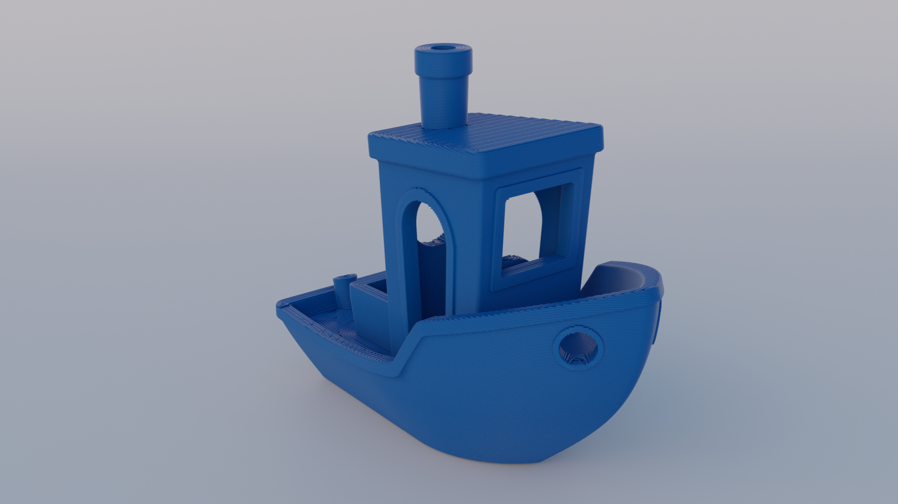
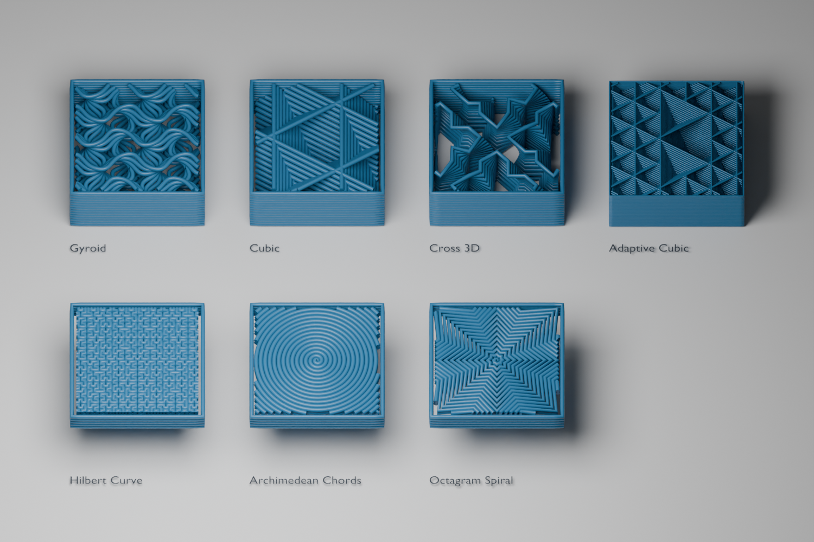
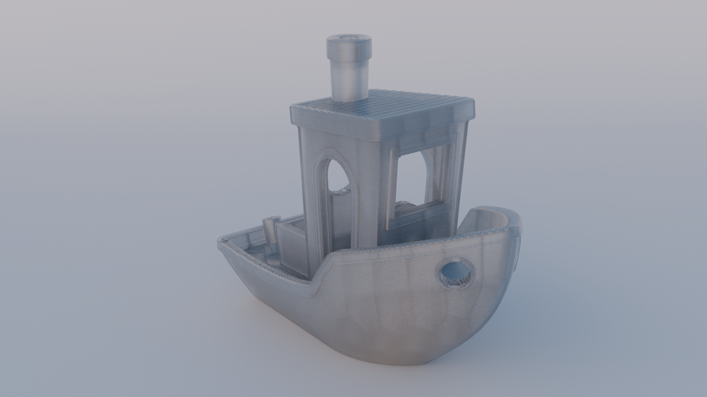
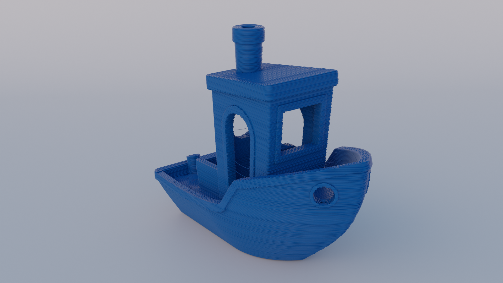

# FDMfier

FDM print previews for Blender, with visible layers, patterned infill, and adjustable imperfections.

**[Download 1.0.10](https://github.com/nikgrv/FDMfier/releases/tag/v1.0.10)** · **[Blender Extensions](https://extensions.blender.org/add-ons/fdmfier/)** · **[Usage guide](docs/USAGE.md)** · **[Changelog](CHANGELOG.md)**

FDMfier makes a closed mesh look like it came off an FDM printer. Set the layer
height, walls, and infill, then add a seam, supports, or a little stringing.
Reveal the print layer by layer or bake it to an editable mesh for your render.
The preview keeps the source model’s size and position.

## Download

Requires **Blender 5.2 LTS or later**. Choose the unified ZIP or the package for
your system. Use the extension ZIP when installing through Blender.

| Package | Download | Testing |
| --- | --- | --- |
| Unified | [FDMfier-1.0.10.zip](https://github.com/nikgrv/FDMfier/releases/download/v1.0.10/FDMfier-1.0.10.zip) | Apple Silicon with Blender 5.3 |
| Apple Silicon | [macOS ARM64](https://github.com/nikgrv/FDMfier/releases/download/v1.0.10/FDMfier-1.0.10-macos_arm64.zip) | 1.0.10 tested with Blender 5.3 |
| Windows | [Windows x64](https://github.com/nikgrv/FDMfier/releases/download/v1.0.10/FDMfier-1.0.10-windows_x64.zip) | Earlier release tested with Blender 5.2; 1.0.10 testing pending |
| Linux | [Linux x64](https://github.com/nikgrv/FDMfier/releases/download/v1.0.10/FDMfier-1.0.10-linux_x64.zip) | Untested |
| Intel Mac | [macOS x64](https://github.com/nikgrv/FDMfier/releases/download/v1.0.10/FDMfier-1.0.10-macos_x64.zip) | Untested; requires a custom Blender build with Python 3.13 |

1. Open **Edit → Preferences → Add-ons**, open the menu, and choose **Install from Disk**.
2. Select the downloaded ZIP and enable **FDMfier** if needed.
3. Select a solid mesh, open the 3D Viewport sidebar with **N**, and choose **FDMfier → Generate**.

## New in 1.0.10

Four more infill patterns, plus three new patterns for the top and bottom.
Choose each surface pattern independently, then regenerate the preview.

| Infill | Top and bottom surfaces |
| --- | --- |
| Lines · Parallel Lines · Grid · Triangles · Concentric · Honeycomb | Alternating Lines · Parallel Lines · Concentric |
| **Gyroid · Cubic · Cross 3D · Adaptive Cubic** | **Hilbert Curve · Archimedean Chords · Octagram Spiral** |

Adaptive Cubic makes smaller cells near model surfaces and larger cells inside.
Its density sets the finest cell spacing. Cross 3D uses FDMfier’s own fractal
construction, so its paths can differ from Cura’s.

## Adjust the print

| Control | What you can change |
| --- | --- |
| Layers and walls | Layer height, extrusion width, wall count, and separate top and bottom layer counts |
| Imperfections | Width variation, layer drift, stringing, and droop, with an optional vertex group mask and invert control |
| Supports | Standard or Tree, an overhang angle threshold, and Build Plate Only |
| Bed adhesion | Skirt loops and offset, or brim width |
| Live preview | Visible layers, seam placement, and imperfection strengths in viewport and render |
| Preparation | Lay on Selected Face, Auto Orient, a vertex estimate, and Repair / Remesh Copy |

Slicing changes take effect on **Regenerate**. Live Geometry Nodes controls
update immediately. Default settings use **0.30 mm layers**, **two wall lines**,
**15% Grid infill**, and **four top and bottom layers**.

## Materials and baking

<table>
<tr>
<td width="50%"></td>
<td width="50%"></td>
</tr>
<tr>
<td>Translucent material</td>
<td>Adjustable print imperfections</td>
</tr>
</table>

Enable **Fuse for Translucency** to join overlapping extrusion beads into a
shell while preserving rounded layer ridges, surface patterns, and the air spaces
in sparse infill. **Original Boolean (V1)** is the default. **Four-Layer Boolean**
is available for faster baking.

**Bake to Mesh** creates an editable object at the current reveal height and
hides the source and live preview. Blender pauses during fused baking.
**Show Live Preview** brings the preview back.

FDMfier creates visual replicas for renders. Use a dedicated slicer to prepare
printer toolpaths and G-code. The input should be a closed mesh solid. See the
usage guide for thin features, support coverage, and geometry limits.

## Roadmap

- [ ] Improve slicing and fusion performance while retaining layer detail and translucent rendering quality.
- [ ] Test the current release on Windows, Linux, and Intel Mac builds.
- [ ] Add easier controls for print animations.
- [ ] Expand infill and surface pattern options.
- [x] Support Blender 5.2 LTS.
- [x] Confirm an earlier release works on Windows x64 with Blender 5.2.
- [x] Add Gyroid, Cubic, Cross 3D, Adaptive Cubic, and more surface patterns.

[Usage and build instructions](docs/USAGE.md) · [Release history](CHANGELOG.md) · [Report an issue](https://github.com/nikgrv/FDMfier/issues)

Made by **Nikita Goryainov — nik.grv**. Licensed under **GPL-3.0-or-later**.
