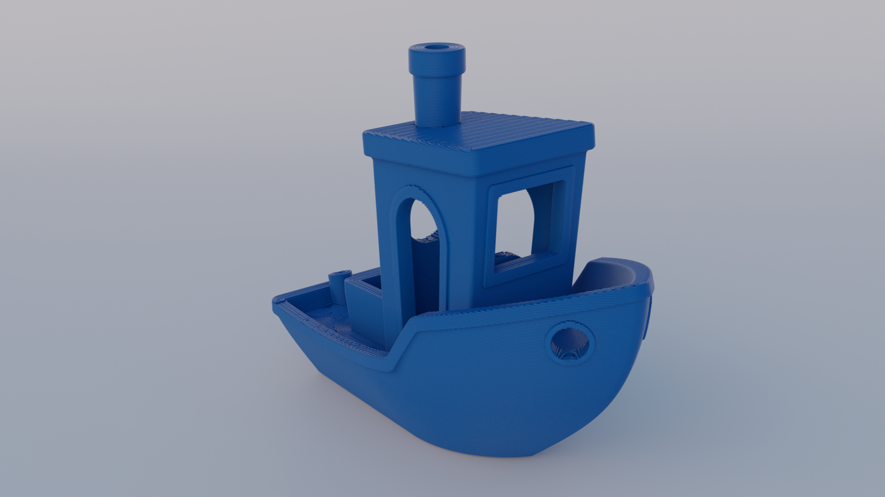
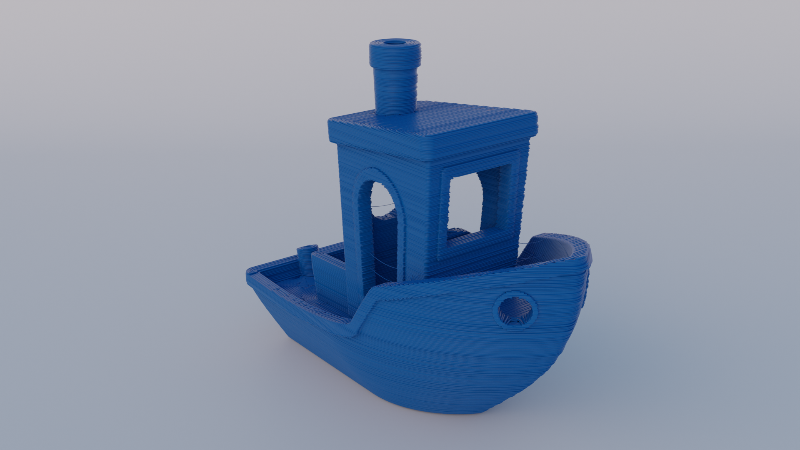
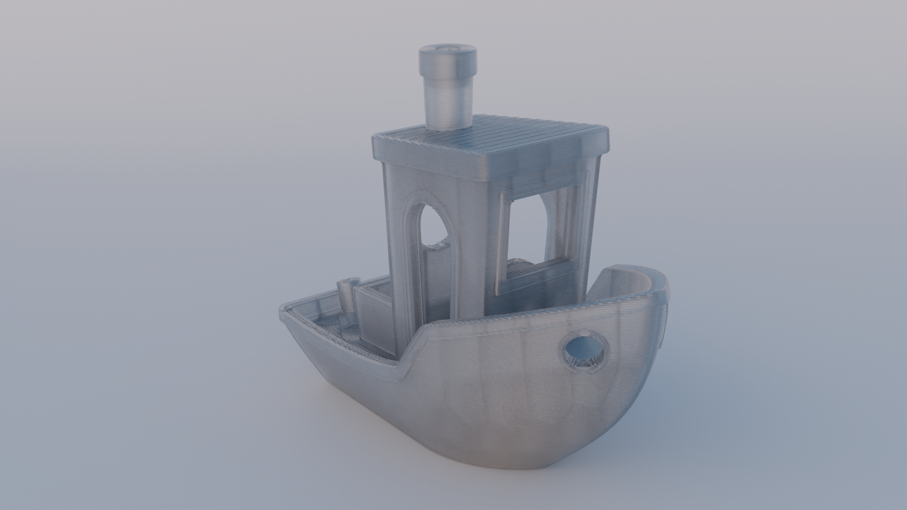

# FDMfier 1.0.7

FDMfier now supports Blender 5.2 LTS. The same installation ZIP includes the dependencies for Windows x64, Apple Silicon, Linux x64 and ARM64, and custom Intel Mac builds.

**Fuse for Translucency** now offers two bake methods. **Original Boolean (V1)** is the default and prioritizes layer detail and translucency. **Four-Layer Boolean** is available for faster bakes. Saved Four-Layer selections carry over, and old Direct Shell selections open with Original Boolean.

## Testing checklist

- [x] Blender 5.2 LTS support
- [x] Windows x64 with Blender 5.2, confirmed by the maintainer
- [x] Apple Silicon with Blender 5.3
- [ ] Intel Mac
- [ ] Linux

Download `FDMfier-1.0.7.zip` and install it from **Edit → Preferences → Add-ons → Install from Disk**. Then open **FDMfier** in the 3D Viewport sidebar.

## Benchy renders

