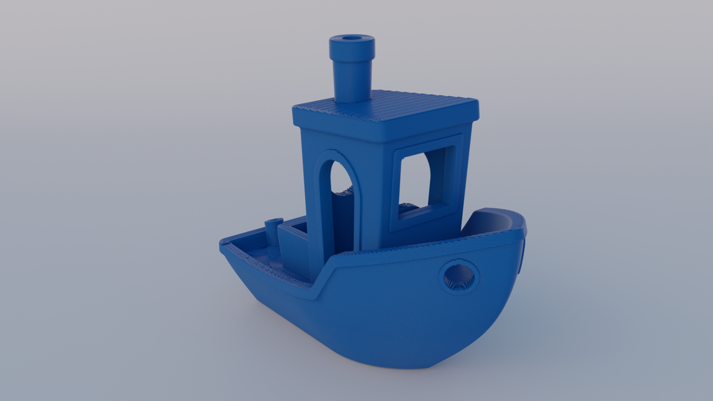
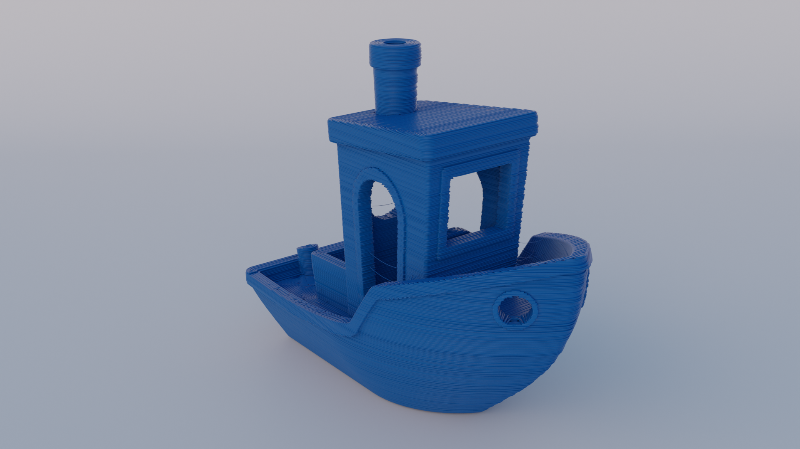
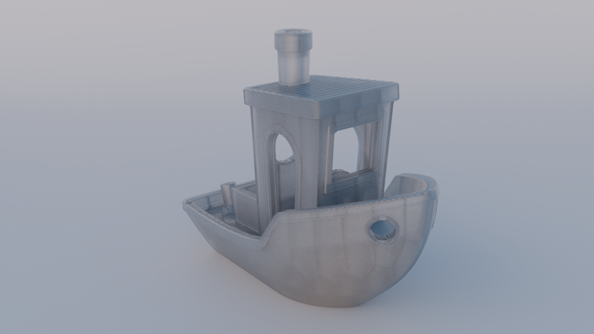

# FDMfier 1.0.8

This release fixes two Blender Extensions manifest validation errors. The package now uses schema `1.0.0` and lists Linux x64 alongside Windows x64, Apple Silicon, and custom Intel Mac builds. Blender 5.2 LTS remains the minimum version.

## Testing checklist

- [x] Blender 5.2 LTS support
- [x] Windows x64 with Blender 5.2, confirmed by the maintainer on 1.0.7
- [x] Apple Silicon with Blender 5.3
- [ ] Intel Mac
- [ ] Linux x64

Download `FDMfier-1.0.8.zip` and install it from **Edit → Preferences → Add-ons → Install from Disk**. Open **FDMfier** in the 3D Viewport sidebar.

## Benchy renders

